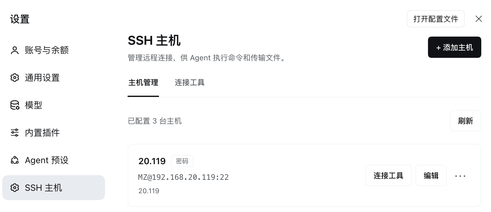
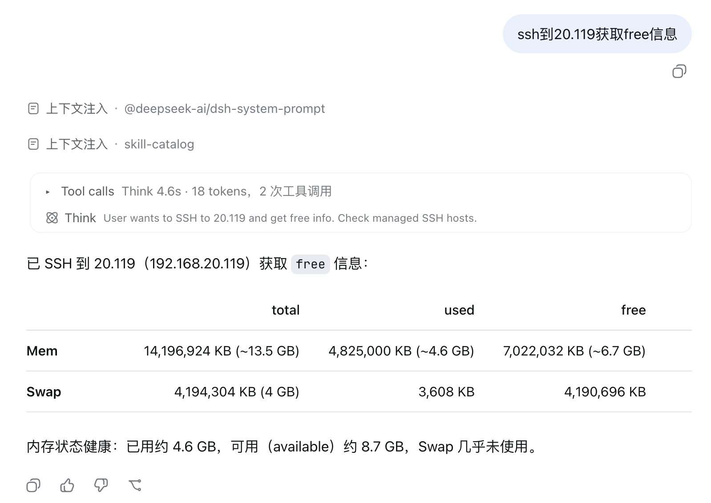

# dsh-ssh

为 **DeepSeek Harness** 提供 SSH 主机管理、远程命令执行与文件传输。

在设置中保存一次连接信息，即可让任意 Agent 会话使用 SSH 工具；也可以直接在界面中测试连接、上传和下载文件。



[安装](#安装) · [开始使用](#开始使用) · [工具一览](#工具一览) · [更新与卸载](#更新与卸载) · [常见问题](#常见问题) · [开发说明](#开发说明)

## 功能

| 能力 | 说明 |
| --- | --- |
| 主机管理 | 添加、编辑、复制和删除主机，统一保存连接信息 |
| 多种认证 | 支持 SSH Agent、私钥和密码认证 |
| 远程执行 | 支持多行脚本；自动选择 bash，无 bash 时回落到 sh/ash |
| 文件传输 | 上传本地文件、下载远端文件，自动创建父目录；上传最大 128 MB |
| 图形界面 | 主机管理与连接工具分开，认证字段按所选方式显示 |
| Agent 工具 | 安装到对应 profile 后，各会话可使用全部 8 个 SSH 工具 |

## 安装

当前插件版本为 **2.2.2**，已在 **DeepSeek Harness 桌面版 0.2.2-rc.1** 验证。运行环境需要本机 SSH 客户端；Node.js 要求为 22 或更新版本。

### 桌面版（推荐）

通过桌面应用内的插件管理器安装：

1. 打开「插件」→「添加插件」→「安装第三方插件」。
2. 在「包名或地址」填写仓库地址：

   ```text
   https://github.com/dmz2922990/dsh-ssh.git
   ```

3. 完成安装后，完全退出并重新打开应用。
4. 打开「设置」→「SSH 主机」。

本地开发时，也可以填写已克隆仓库的**绝对目录路径**。

> 桌面版的 `desktop` profile 由应用管理，不能通过 `dsh plugin --profile desktop` 安装。插件会自动注册，无需手动编辑 profile 配置。

### Web 版

```bash
npx @deepseek-ai/dsh@0.2.2-rc.1 plugin --profile web add https://github.com/dmz2922990/dsh-ssh.git
```

安装后重启 Web 进程。本地开发时可将仓库地址替换为本机仓库的绝对路径。

## 开始使用

### 1. 添加主机

在「主机管理」中点击「添加主机」，填写主机标识、地址、用户名和端口，再选择认证方式。

| 认证方式 | 需要填写的内容 |
| --- | --- |
| SSH Agent | 使用本机 Agent 或默认 SSH 配置中的身份 |
| 私钥 | 本地私钥文件路径，例如 `~/.ssh/id_ed25519` |
| 密码 | 登录密码；编辑已有主机时，留空保留原密码 |

主机标识供 Agent 引用，创建后不可修改；显示名称可以随时调整。远端 Shell 和备注位于「更多选项」。复制主机会继承源主机的认证信息。

### 2. 测试连接或传输文件

点击主机卡片上的「连接工具」，选择需要的操作：

- **执行命令**：例如 `hostname && uptime`，查看输出与退出码。
- **传输文件**：选择上传或下载，填写本地和远端路径。

### 3. 让 Agent 使用主机

在会话中直接描述目标和操作，例如：

```text
列出已配置的 SSH 主机。
在 build-server 上执行 hostname 和 uptime。
将本地 /tmp/config.conf 上传到 build-server 的 /tmp/config.conf。
```

Agent 会调用插件工具；使用主机标识可避免名称或地址产生歧义。

<details>
<summary>查看 Agent 调用示例截图</summary>



</details>

## 工具一览

| 工具 | 用途 |
| --- | --- |
| `ssh_host_list` | 列出主机，不返回密码明文 |
| `ssh_host_add` | 添加主机 |
| `ssh_host_update` | 更新指定字段，省略的认证字段保持不变 |
| `ssh_host_copy` | 复制主机及认证信息 |
| `ssh_host_remove` | 删除主机 |
| `ssh_bash` | 执行远程脚本，支持超时和远端 Shell 选择 |
| `ssh_upload` | 上传本地文件 |
| `ssh_download` | 下载远端文件 |

## 配置与数据

| 文件 | 默认位置 | 用途 |
| --- | --- | --- |
| 主机配置 | `~/.dsh/ssh-hosts.json` | 保存主机与认证信息，写入权限为 `0600` |
| 密码辅助脚本 | `~/.dsh/.ssh-askpass.sh` | 为 SSH 提供密码，权限为 `0700` |

设置 `DSH_HOME` 后，这些文件位于对应数据目录。配置采用原子替换写入；损坏或不可读的文件会报错，不会被当成空配置覆盖。

**密码以明文保存在本机配置文件中，建议优先使用私钥。** 主机列表和管理工具返回值仅包含 `hasPassword`，不返回密码。不要让多个进程同时修改同一份主机配置，也不要同时挂载多份插件。

## 更新与卸载

**桌面版**：在应用内「插件」页面管理 `dsh-ssh`，使用可用的更新或卸载操作。切换安装来源时，先卸载，再从新来源安装。

**Web 版**：

```bash
# 更新
npx @deepseek-ai/dsh@0.2.2-rc.1 plugin --profile web update dsh-ssh

# 卸载
npx @deepseek-ai/dsh@0.2.2-rc.1 plugin --profile web remove dsh-ssh
```

**更新后请完全退出并重新打开应用。** 本地目录通常以 `link:` 安装：页面代码可能自动刷新，但后端不会自动重载；仅关闭设置、关闭窗口或刷新页面不一定生效。macOS 可使用 ⌘Q 退出，并在重开后核对插件详情中的版本。

卸载保留主机配置和认证信息，重新安装可以继续使用。运行中的工具、路由和页面会随插件释放，命令会收到取消信号。需要清除数据时，先备份，再单独删除上述两个文件，不要删除整个 DSH 数据目录。手动添加过插件挂载行的用户，还需移除对应配置。

## 常见问题

### 页面报 HTTP 404 / 405

先核对「插件 → dsh-ssh」中的运行版本，并完全退出应用再打开。本地链接安装可能出现“页面已更新、后端仍运行旧代码”的情况，无需反复卸载。

### 出现 `unix_listener: cannot bind ... Operation not permitted`

旧版本可能继承本机 SSH 连接复用配置，在受限目录创建控制套接字时失败。2.2.2 已统一为执行、上传和下载关闭连接复用。请更新并完全重启，无需修改 `~/.ssh/config` 或扩大目录权限。

### 出现后量子密钥交换警告

该警告说明当前连接未使用后量子密钥交换。是否执行成功应结合退出码、超时和中止状态判断；插件保留警告及默认算法协商。服务器侧可升级支持相应算法的 SSH 实现，参见 [OpenSSH 官方说明](https://www.openssh.org/pq.html)。

### 从旧预设或动态插件迁移

当前仅维护 Host bundle，旧 `preset/`、动态 `plugin/` 和独立 `webapi.mjs` 入口已移除。

1. 备份原主机配置；自定义 `DSH_HOME` 时，将其放入对应数据目录。
2. 移除旧动态插件和手动挂载行，停止使用旧「SSH Agent」预设。
3. 安装当前插件，重启后使用内置预设创建会话。

## 开发说明

### 服务 API

其他插件可声明依赖 `ssh.hosts`，再调用服务：

```js
const ssh = ctx.get('ssh.hosts')
await ssh.list()
await ssh.get(ref)
await ssh.add({ id, host, port, user, name, note, shell, auth: { type, keyPath, password }, tags })
await ssh.update(id, patch)
await ssh.copy(ref, { id, host, name })
await ssh.remove(id)
await ssh.bash(ref, command, timeoutMs, shell)
await ssh.upload(ref, localPath, remotePath)
await ssh.download(ref, remotePath, localPath)
```

`ref` 支持主机标识、名称、`user@host` 或地址。更新时省略认证字段以保留原值。

### 实现与验证

- 设置页面复用 Harness 的认证通道 `/api/dsh-ssh/request`。
- 远程脚本通过 SSH stdin 传入；密码认证使用 `SSH_ASKPASS`，无需 sshpass 或 pty。
- 文件通过 base64 over SSH 传输，无需 scp。
- 显式关闭 `ControlMaster`、`ControlPath` 和 `ControlPersist`，其他 SSH 配置仍可生效。

```bash
npm test

# 加载目标 Harness 的真实运行时，执行额外集成测试
DSH_RUNTIME_DIR=/absolute/path/to/harness/node_modules npm test
```

未设置 `DSH_RUNTIME_DIR` 时，三项运行时集成测试会明确跳过。自动化测试使用临时配置，不连接真实 SSH 主机。
