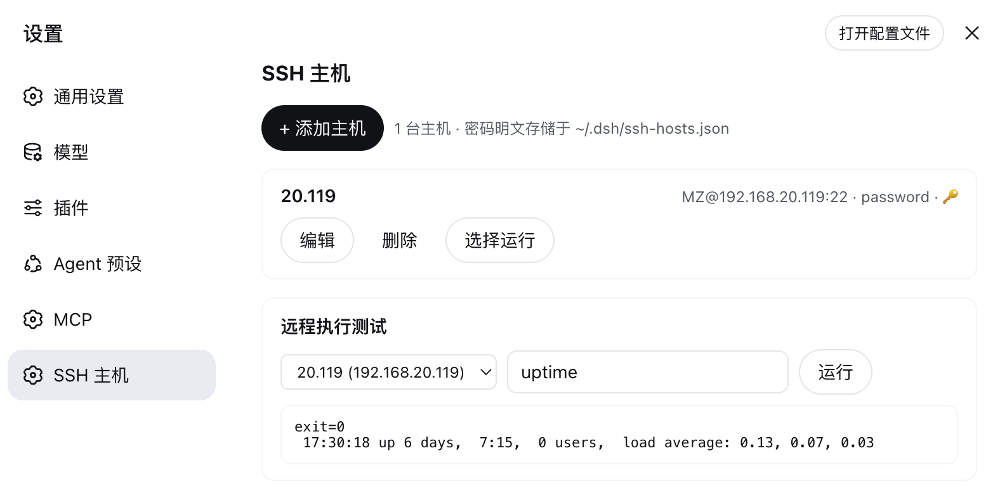
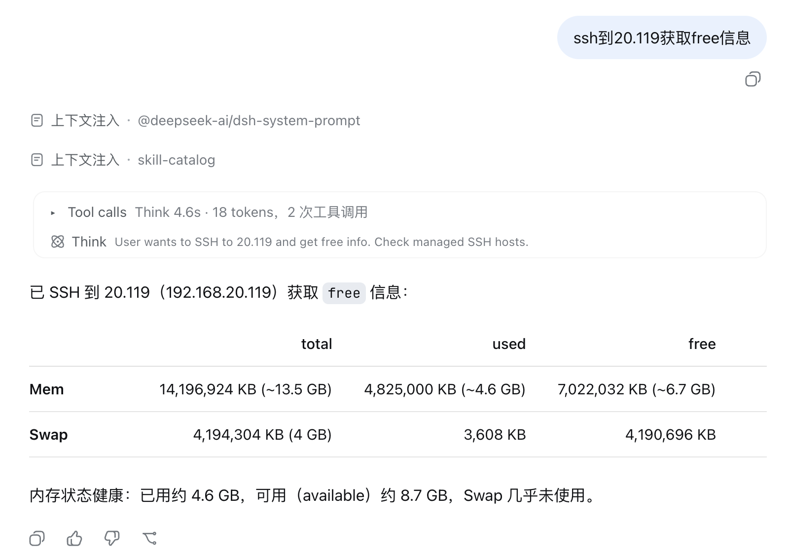

# dsh-ssh

DeepSeek Harness (DSH) 插件：**SSH 主机管理 + 远程 Bash 执行**。

当前版本面向 **DeepSeek Harness 桌面版 0.2.2-rc.1**，使用一个 Host bundle 注册服务、工具和设置页面。安装到对应 profile 后，所有 session（任意 preset）的 Agent 均可使用 SSH 工具。设置页面默认展示主机列表，新增和编辑按连接信息、身份认证、更多选项分组；执行命令与文件传输位于「连接工具」。桌面与 Web 提供「SSH 主机」设置页面；不提供浏览器界面的 profile 仅注册服务和工具。

## 截图

### SSH 主机设置页面



### Agent 使用 ssh_bash



## 功能

- **主机管理（增删改查、复制）**：持久化到 `$DSH_HOME/ssh-hosts.json`，未设置 `DSH_HOME` 时为 `~/.dsh/ssh-hosts.json`。
- **模型工具**：`ssh_host_list` / `ssh_host_add` / `ssh_host_update` / `ssh_host_remove` / `ssh_host_copy` / `ssh_bash` / `ssh_upload` / `ssh_download`。
- **Cordis 服务 `ssh.hosts`**：供其他声明依赖该服务的插件调用。
- **三种认证**：`agent`（BatchMode 免交互）/ `key`（私钥）/ `password`（`SSH_ASKPASS`，无需 sshpass、不申请 pty）。
- **文件传输**：上传、下载上限 128MB，使用 base64 over ssh，无需 scp，支持 BusyBox 设备，自动创建父目录。
- **自适应远端 Shell**：默认优先 bash，无则回落 sh/ash；可按主机或单次调用指定。

## 安装到桌面版

桌面版 **0.2.2-rc.1 的 desktop profile 由 Electron 应用独占管理**，不能使用 `dsh plugin --profile desktop`，即使 CLI 版本一致也会被拒绝。请保持桌面应用打开，通过应用内插件管理器安装。

1. 打开桌面应用的「插件」页面。
2. 点击「添加插件」→「安装第三方插件」。
3. 在「包名或地址」中填写本机仓库的绝对目录路径，例如：

   ```text
   /Users/Daniel.Duan/Work/DSH/dsh-ssh
   ```

4. 按界面完成安装；如提示重启，重启桌面应用。随后在设置中打开「SSH 主机」。

安装器支持本地目录、npm 包和 Git 仓库地址。当前本地修复尚未发布到远端时，请使用本地目录。插件声明了 `dsh.bundle`，安装器会自动管理 bundle 层，无需手动编辑 desktop profile 的 `package.json` 或 `cordis.patch.yml`。

本地目录通常以 `link:` 安装。修改本仓库后，页面代码可能自动刷新，但后台 `index.mjs` 不会自动重载。**每次修改后端后都应完全退出桌面应用（macOS 使用 ⌘Q），再重新打开**，不要只关闭设置或刷新页面。在「插件 → dsh-ssh」详情中确认已加载版本；若新版页面出现 HTTP 404/405，先检查后台是否仍为旧版本，无需反复卸载。

## 安装到 Web 版

Web profile 可以使用 CLI：

```bash
npx @deepseek-ai/dsh@0.2.2-rc.1 plugin --profile web add /absolute/path/to/dsh-ssh
```

安装后重启 Web 进程。不要将同一插件安装、手动挂载或动态加载多份，也不要让多个进程同时修改同一份主机配置。

## 更新与卸载

**桌面版**：在应用内「插件」页面管理 `dsh-ssh`。有「更新」操作时通过该操作更新；切换安装来源（例如从 Git 改为本地目录）时，先卸载，再通过「添加插件」安装本地目录。卸载使用插件条目的「卸载」操作，并按界面提示重启。

**Web 版**：可通过对应 profile 的 CLI 操作：

```bash
npx @deepseek-ai/dsh@0.2.2-rc.1 plugin --profile web update dsh-ssh
npx @deepseek-ai/dsh@0.2.2-rc.1 plugin --profile web remove dsh-ssh
```

卸载或禁用插件会释放工具、RPC 处理程序、设置页面和样式，并取消该实例正在运行的命令。**主机配置和认证信息会保留**，重新安装可继续使用。需要清除数据时，先自行备份，再单独删除数据目录中的 `ssh-hosts.json` 和 `.ssh-askpass.sh`；不要删除整个 DSH 数据目录。

若曾手动将 `dsh-ssh` 插件行添加到 profile 覆盖配置，卸载时也需移除该手动配置，以免留下无法解析的插件行。

## 从旧预设或动态插件迁移

新版 Harness 使用声明式 Agent preset，不再通过 `~/.dsh/.agent-presets/ssh` 自动发现本插件。当前发布只保留 Host bundle，不再提供旧 `preset/`、动态 `plugin/` 或独立 `webapi.mjs` 入口。

1. 备份原 `~/.dsh/ssh-hosts.json`；使用自定义数据目录时，将文件放到对应 `$DSH_HOME` 下。
2. 卸载会话中原来的动态 SSH 插件，移除手动挂载的旧 SSH preset/plugin 行，停止使用旧「SSH Agent」预设；确认无引用后再清理旧预设目录。
3. 按上述步骤安装 Host bundle，重新启动应用，以当前内置预设创建会话。

不要同时运行新旧入口：它们会注册同名工具，并可能用各自缓存覆盖同一份配置。

## 配置与通信

主机配置采用原子替换写入，新文件权限为 `0600`。配置文件损坏、格式不合法或不可读时会显示错误，不会把它当成空配置后覆盖。插件实例内的修改按顺序保存；不支持多个进程同时编辑同一文件。

设置页面通过 Harness Connection RPC `/api/dsh-ssh/request` 与后端通信，复用 Harness 的连接与认证。旧 `/dsh-ssh/api/*` HTTP 接口不再提供。桌面版内置的浏览器界面也使用这套 RPC；无浏览器服务时仍可使用模型工具。

## 远程执行原理

```bash
ssh -o StrictHostKeyChecking=accept-new -o ConnectTimeout=15 -o ControlMaster=no -o ControlPath=none -o ControlPersist=no [-i key] [-p port] user@host -- bash -s
```

脚本通过 stdin 传给远端 shell。密码认证使用 `SSH_ASKPASS` 和 `SSH_ASKPASS_REQUIRE=force`；辅助脚本位于数据目录的 `.ssh-askpass.sh`，权限为 `0700`，仅读取进程环境中的密码。

插件的执行、上传、下载均使用独立连接，显式关闭 `ControlMaster`、`ControlPath` 和 `ControlPersist`，避免继承本机连接复用配置后尝试在 `~/.ssh` 创建控制套接字而被执行环境拒绝。其余 SSH 配置仍可正常生效，无需修改用户 SSH 配置或扩大目录权限。

如果输出包含 `connection is not using a post-quantum key exchange algorithm`，这是当前连接未使用后量子密钥交换的安全警告，不能仅凭该警告判断命令失败；实际结果由退出码、超时或中止状态决定。插件保留警告和默认算法协商，服务器侧可通过升级 SSH 实现改善协商。[OpenSSH 官方说明](https://www.openssh.org/pq.html)。

## `ssh.hosts` 服务 API

调用方应声明对 `ssh.hosts` 的依赖，再读取服务：

```js
const ssh = ctx.get('ssh.hosts')
await ssh.list()                              // Redacts passwords.
await ssh.get(ref)                            // ref: id | name | user@host | host
await ssh.add({ id, host, port, user, name, note, shell, auth: { type, keyPath, password }, tags })
await ssh.update(id, patch)                   // Omit auth fields to preserve credentials.
await ssh.remove(id)
await ssh.bash(ref, command, timeoutMs, shell) // Returns execution status and output.
await ssh.upload(ref, localPath, remotePath)   // Maximum 128MB.
await ssh.download(ref, remotePath, localPath) // Maximum 128MB.
await ssh.copy(ref, { id, host, name })        // Copies credentials without returning them.
```

## 认证信息

- 密码以**明文**保存在主机配置文件中，建议优先使用密钥认证。
- 主机列表与工具返回值不含密码明文，只返回 `hasPassword` 布尔值。

## 开发验证

运行 `npm test` 验证存储、执行接口和设置页面。设置 `DSH_RUNTIME_DIR` 为目标 Harness 的 `node_modules` 目录后，还会运行真实 Cordis/Tools 生命周期集成测试；未设置时会明确跳过这三项。验证使用临时数据，不会连接真实 SSH 主机。
